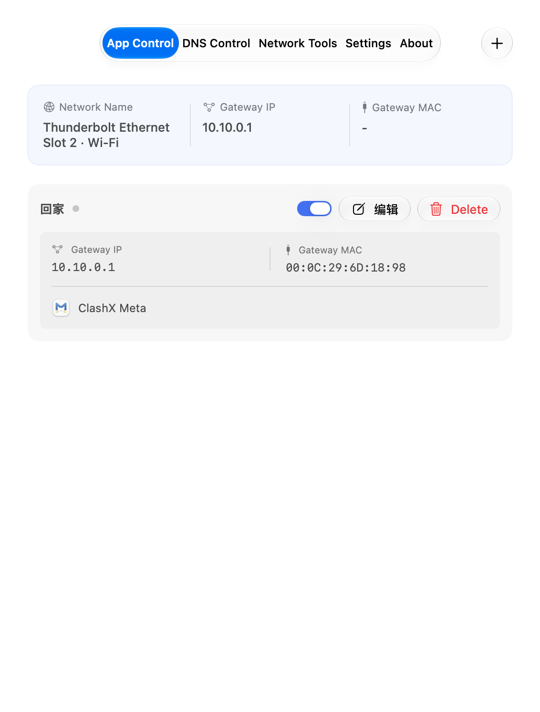
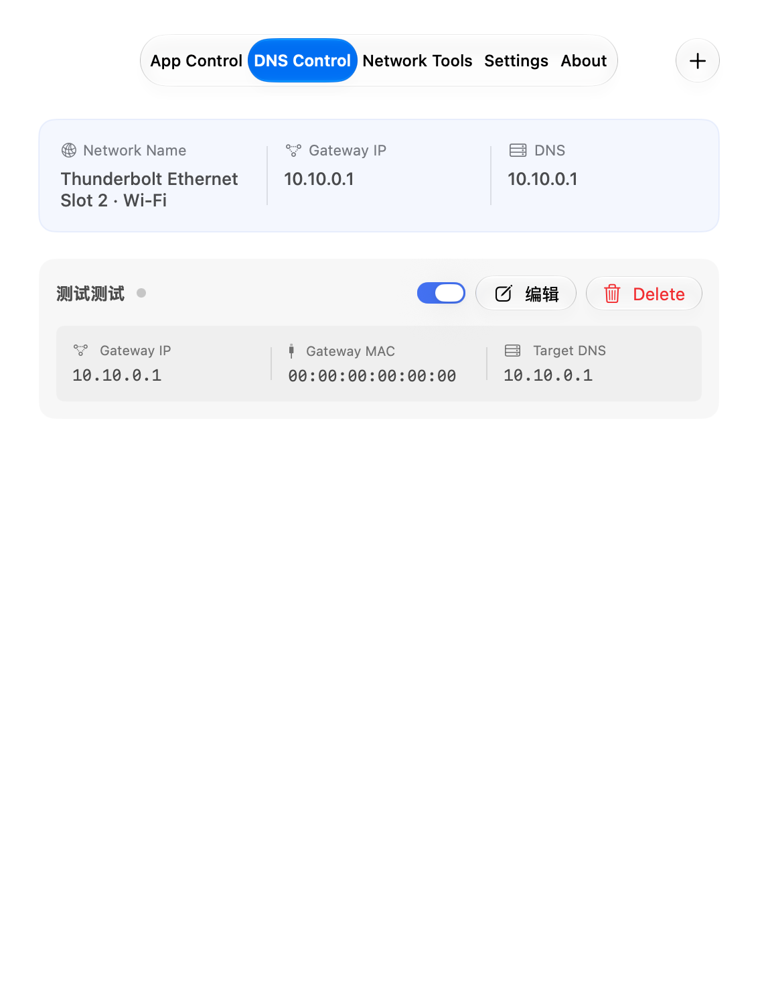
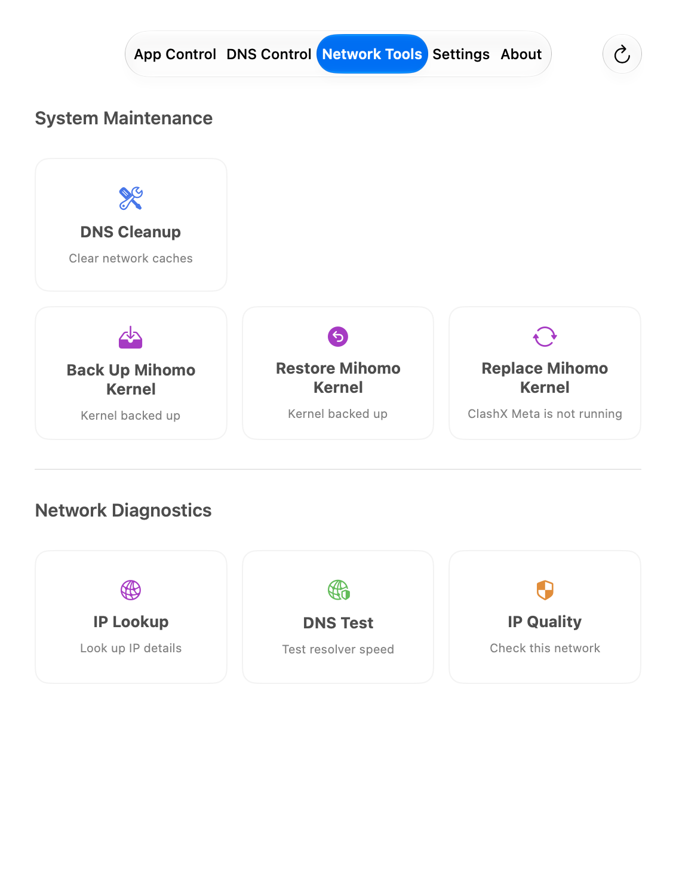
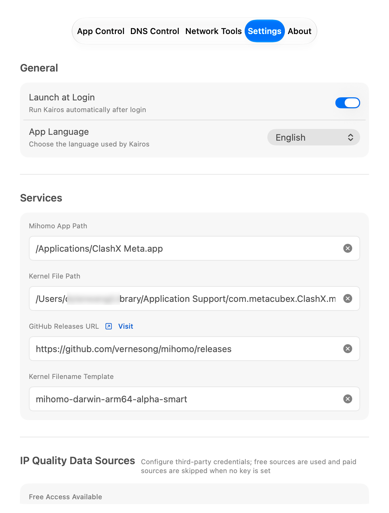

<div align="center">
  
  <h1>Kairos</h1>
</div>

<div align="center">
  <p>Network scenes, diagnostics, and Mihomo kernel maintenance from the macOS menu bar.</p>
  <p>
    <a href="docs/README.zh-CN.md">简体中文</a> ·
    <a href="docs/README.zh-TW.md">繁體中文</a> ·
    <strong>English</strong> ·
    <a href="docs/README.ja.md">日本語</a> ·
    <a href="docs/README.ru.md">Русский</a>
  </p>
</div>

Click the menu-bar icon to open Kairos. Click it again or click outside the panel to hide it. Reopening it during the same session restores your page, inputs, and task results.

App Control and DNS Control have separate tabs. Network Tools brings together diagnostics and maintenance; Settings holds service configuration, permissions, and logs. About shows the app version and update check. Tools and scene editors open as detail pages inside the same panel, with a back button to return.

The app interface supports English, Simplified Chinese, and Traditional Chinese. It follows the macOS language by default, or you can choose a language under Settings → General; changing it takes effect after Kairos restarts.

## Network scenes

Kairos observes network-path changes and reads the default gateway's IP address and MAC address. A scene matches only when both values exactly match the enabled rule.

- An app-control scene can close its listed apps when the rule becomes active, then reopen apps that are no longer controlled after the scene changes.
- A DNS scene can apply its configured primary and optional secondary resolver to the current interface. It uses the privileged DNS Helper for this operation.
- A scene is not a proxy profile. Kairos does not create, edit, select, or apply proxy settings. Use your proxy client for that.

The matching values are visible in the app, so they can be copied into a rule for a network you trust.

## What is included

<table>
  <tr>
    <td width="32%">
      <strong>App Control</strong><br><br>
      View the network name, gateway IP, and gateway MAC, then create scenes to quit selected apps when the gateway matches. Each card keeps its enable switch, edit and delete actions, and matching-status dot together.
    </td>
    <td width="68%"></td>
  </tr>
  <tr>
    <td>
      <strong>DNS Control</strong><br><br>
      View the current network, gateway IP, and DNS. Create separate DNS scenes with a primary and optional secondary resolver; the dot beside each scene name indicates whether its gateway rule matches.
    </td>
    <td></td>
  </tr>
  <tr>
    <td>
      <strong>Network Tools</strong><br><br>
      System Maintenance contains DNS cleanup and Mihomo kernel backup, restore, and replacement. Network Diagnostics contains IP Lookup, DNS Test, and IP Quality. Click a card to open its inputs, progress, and results inside the panel.
    </td>
    <td></td>
  </tr>
  <tr>
    <td>
      <strong>Settings</strong><br><br>
      Manage launch at login, language, Mihomo paths and downloads, IP-data credentials, configuration import/export, permissions, and logs. Save Mihomo and API-key changes with the checkmark at the top right. Reveal the current log file in Finder from the Logs group.
    </td>
    <td></td>
  </tr>
</table>

The deep-clean tool temporarily disconnects Wi-Fi while it clears DNS and ARP caches, resets the interface, clears Chrome and Firefox caches, and performs the final system cleanup. Expect a short interruption of roughly 2–5 seconds.

## DNS Helper and permissions

DNS changes and the deep-clean operation require Kairos's separately installed `SMAppService` LaunchDaemon. Register it in Settings, enter an administrator password when macOS asks, and approve it in System Settings if approval is required. The Helper can set or clear DNS servers, flush the DNS cache, and perform the privileged maintenance steps.

Accessibility permission is needed when an app-control scene must quit another app. Kairos can still monitor the network without it. Kairos can replace Mihomo kernels only at user-writable paths outside app bundles; protected locations require manual handling.

## Mihomo

Mihomo backup, restore, and replacement are under Network Tools → System Maintenance. Configure the associated app, kernel path, GitHub Releases URL, and filename template under Settings → Services.

Kairos does not include a Mihomo client or manage proxy rules. You choose the host app and its kernel file yourself. Kairos can back up and restore that file, or download the latest prerelease asset that matches the configured filename template from a GitHub Releases URL (the default is `vernesong/mihomo`). It asks you to quit the associated app before changing its kernel.

## IP data and API keys

An IP lookup entered in the app is sent to [ipapi.is](https://ipapi.is). The IP-quality check first discovers the public IP through `api64.ipify.org`, `checkip.amazonaws.com`, or `icanhazip.com`, then sends that IP to the sources below in parallel. A DNS benchmark sends the selected domain names directly to the resolver being tested.

IP Lookup also uses the ipapi.is key saved in Settings. Without a key, the provider currently allows 30 lookups per public IPv4 address or IPv6 /64 per UTC day and returns basic ownership and location only. Missing fields appear as “—”; a map is shown only when coordinates are available. A keyed request returns the full response within the account’s quota. See the [provider documentation](https://ipapi.is/developers.html) for current limits.

| Source | Without a key | With your key |
|---|---|---|
| IPinfo, ipapi.is, DB-IP, IPWHOIS | Kairos uses their available free endpoint. | Kairos uses the provider's keyed endpoint when applicable. For IPinfo, a configured token selects the official endpoint directly; without one, Kairos uses the widget endpoint. Request failures are reported. |
| AbuseIPDB, IP2Location, ipregistry | Skipped. | Included in the IP-quality check. |

Configure keys in Settings only if you want the keyed sources or their higher limits. Kairos stores them in local `UserDefaults`; it does not provide its own relay service. A settings export (`.kairos`) includes API keys as well as scenes and Mihomo settings, so treat that file as sensitive and do not share it.

Provider responses are used to show location, ASN/organization, network type, and available privacy or abuse signals. Results can differ between providers and should not be treated as a security verdict.

## Install

### Homebrew

```bash
brew tap slippindylan/tap
brew trust --tap slippindylan/tap
brew install --cask kairos
```

### DMG

Download the latest DMG from [GitHub Releases](https://github.com/SlippinDylan/Kairos/releases), open it, and drag `Kairos.app` to `Applications`.

The release is signed with an Apple Development certificate but is not notarized by Apple. Apps downloaded from the internet receive macOS's quarantine attribute; Gatekeeper may therefore block the first launch. If you trust the release, remove that attribute after copying the app:

```bash
sudo xattr -rd com.apple.quarantine /Applications/Kairos.app
```

## Requirements and source build

- macOS 26.0 Tahoe or later
- Apple Silicon (arm64)

For a local build, use macOS 26 or later with Xcode 26 or later. Open `Kairos.xcodeproj` and run the `Kairos` scheme. Debug uses local ad hoc signing without an Apple account; privileged Helper features require both the app and Helper to be signed with a valid team certificate. See [local development](docs/development.md) for details.

## License

Copyright © 2025–2026 SlippinDylan Studio. Kairos is licensed under the [Apache License 2.0](LICENSE).
